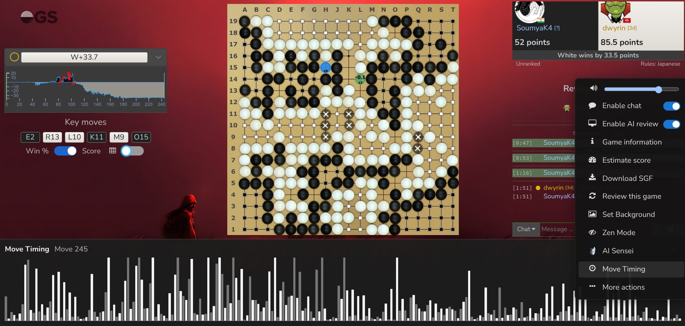
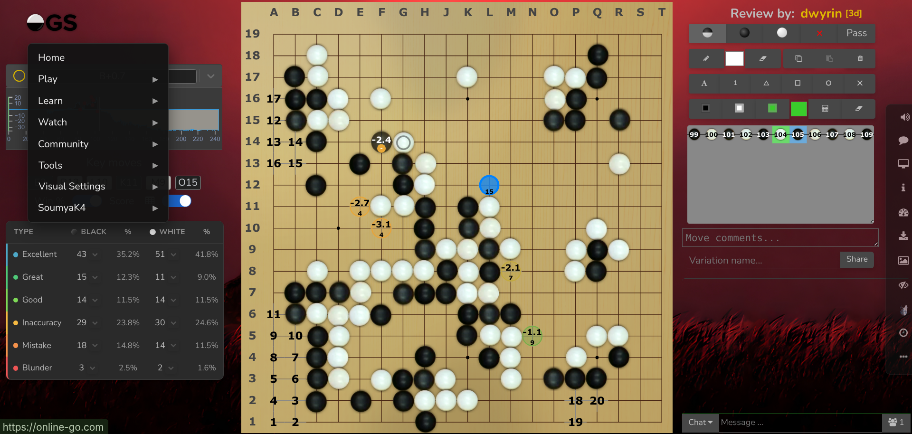

# OGS Custom Cosmetics + UI/UX

A Tampermonkey userscript with background images across Online-Go.com, logo navigation and player search on game/Joseki/Kibitz pages, plus a compact board-focused layout and game tools.

## Install

1. Install [Tampermonkey](https://www.tampermonkey.net/) in your browser.
2. Open the [raw userscript](https://raw.githubusercontent.com/SoumyaK4/OGS-Tampermonkey/main/OGS-Cosmetic.user.js).
3. Confirm the installation in Tampermonkey.

You can download the board theme from [SoumyaK4-OGS-Theme.json](https://github.com/SoumyaK4/OGS-Tampermonkey/blob/main/SoumyaK4-OGS-Theme.json).

The saved background applies to every OGS page. Layout and navigation changes are limited to:

- `https://online-go.com/joseki/*`
- `https://online-go.com/kibitz/*` and `/kibitz` (logo navigation)
- `https://online-go.com/game/*`
- `https://online-go.com/review/*`
- `https://online-go.com/demo/*`

## Feature switches

Open the script in Tampermonkey's editor. The first code block after the required userscript metadata contains the `FEATURES` switches. Change any `true` to `false`, save, and reload OGS. To disable the whole script, use Tampermonkey's own enable/disable control.

| Switch | Controls |
| --- | --- |
| `compactLayout` | Compact Joseki board/sidebar and game layout |
| `logoNavigation` | Replacement logo menu; disable to keep the OGS navbar |
| `goTVIndicator` | Live GoTV count beside the logo; requires `logoNavigation` |
| `customDock` | Right Dock; disable to keep the native toolbar or Dock |
| `customBackground` | Saved background on every OGS page; picker in the Dock and logo's Tools menu |
| `leftAIReview` | AI in the left column, or bottom right when chat is on the left; requires `compactLayout` and a wide desktop window |
| `compactAnalysis` | Aligned analysis tools and one-line move comments |
| `hideMoveControls` | Hide desktop move controls; requires `wheelNavigation` |
| `hideRematch` | Hide the sidebar Rematch button |
| `aiSensei` | Dock's AI Sensei link, on game pages only |
| `tsumegoDragon` | Dock's Tsumego Dragon review link, on game pages only |
| `kifubara` | Dock's Kifubara SGF import button, on game pages only |
| `moveTiming` | Dock's timing chart |
| `wheelNavigation` | Game/Joseki/Kibitz mouse-wheel move navigation and modifiers |
| `altClickNavigation` | Game/Joseki/Kibitz: Alt + left-click a stone to jump to the node where it was placed |

Dock buttons require `customDock`. The background picker is also available through **Tools → Set Background** when `logoNavigation` is enabled. Portrait/mobile layouts keep native navigation and controls. Background preferences remain saved when their feature is disabled; choosing **Use OGS Default** restores OGS's own background styling.

## Features

### Site backgrounds, Joseki, and Kibitz

- Shares the saved background across every OGS page. Home and GoTV retain their native navigation, panels, colors, and layout.
- Gives Joseki a centered desktop board and compact sidebar while retaining its native navigation, filters, comments, and practice controls.
- Adds wheel and Alt-click navigation to Joseki through its native move slider, keeping server-loaded position details synchronized and respecting practice-mode restrictions.
- Replaces Kibitz's desktop navbar with the logo menu and frees its height for the board and content. Both desktop sidebars are slightly translucent over saved backgrounds. Wheel and Alt-click navigation follow the board currently displayed, including a draft or posted variation. Native board tools and room controls remain available.
- Keeps native navigation on smaller screens. The custom Dock remains limited to game/review/demo pages.

### Board-focused layout

- Restores a wide, compact desktop layout after the OGS GobanView redesign.
- Keeps the Go board horizontally centered between the left analysis area and right game sidebar.
- Uses transparent empty areas so the selected background remains visible.
- Places the compact result or turn banner directly below the player cards.
- Optionally hides desktop top navigation, bottom move controls, and the sidebar Rematch button.
- Leaves clearance for the collapsed right Dock so analysis tools, the game tree, move comments, and variation controls remain usable.
- When chat is on the left, places the game tree and variation sharing controls above it, below the OGS logo.
- Gives the main analysis toolbar rows a consistent width and alignment.
- Reduces move comments to a one-line default while retaining horizontal and vertical resizing.
- Uses fire as the default last-move marker, with a fire-specific upward offset that aligns the flame's base with the stone. Change `BOARD_EFFECTS.marker` to select crab, ladybug, sakura, or a custom image URL.

### OGS logo navigation

- Hover the OGS logo in the upper-left corner to open the replacement navigation menu.
- Search OGS players in the first menu row, using the same search service as OGS. Arrow keys and Enter select results; Escape or clicking outside dismisses the menu. The logo itself still links to Home.
- The GoTV icon beside the logo mirrors OGS's live stream count and links to GoTV. It follows the native indicator's visibility and stream preferences, appearing when OGS shows it for your account.
- Includes nested Play, Learn, Watch, Community, Tools, and account menus.
- Mirrors the live OGS navbar when available, preserving account- and permission-dependent actions.
- Adds **Year in Review** directly below **Profile** in the signed-in account menu, opening [GotStats](https://avavt.github.io/gotstats/) for your OGS user ID and the latest completed year in a new tab.

### Compact right Dock

The Dock expands on hover or keyboard focus and exposes these controls:

- Master sound volume
- Download SGF
- Estimate score
- Review this game, conditional moves, and other native actions when OGS makes them available (excluding Analyze, Link to game, Fork game, Call moderator, and Add to library)
- Set Background
- Open the current game in AI Sensei, Tsumego Dragon, or Kifubara (game pages only)
- Full-width Move Timing chart
- More Actions menu, including Fork game, Call moderator, links, library actions, SGF with comments, and keyboard shortcuts when available

Dock actions delegate to OGS wherever possible, so native dialogs and game behavior remain intact.

Fork game, Call moderator, and Add to library shortcuts are also hidden when using the native desktop right Dock.

The custom Dock always includes **More actions**. It opens OGS's native menu when available; in native Dock mode, it lists OGS's current dock actions, including the three shortcuts hidden above.

Kifubara loads the current game's SGF from OGS and submits it to Kifubara using Tampermonkey's request API with a POST containing `sgf`, `source=OGS-Tampermonkey`, and `platform=ogs`. The SGF travels in the request body to avoid URL-length limits. The script reads the returned review URL and opens that review in the new tab. Tampermonkey may(?) prompt for the Kifubara connection permission.

### Background choices

Set Background offers four persistent choices:

- Repository default: [`wall.png`](./wall.png)
- Original OGS background
- Any image URL
- A local image uploaded from your computer

Background preferences are saved in browser local storage. Very large uploaded images can exceed the browser storage limit; use a smaller image if that happens.

### AI review layout

- Places the native AI win-rate graph, key moves, toggles, and score-type summary in the left column on wide screens. When left-side chat is enabled, AI review sits at the bottom of the right sidebar, below the game and analysis controls.
- Left-side chat shares its column with the game tree and variation sharing controls during analysis. The right sidebar scrolls when the AI graph and summary table need more room.
- Centers the Win % and Score controls.
- Keeps unused parts of the analysis panel transparent.
- Preserves the native AI review controls and data.

### Move Timing

- Uses timing data already loaded by OGS when available.
- Falls back to the matching OGS game or review API record.
- Shows every move in a full-width bar chart at the bottom of the page.
- Press **T** to toggle Move Timing on desktop game/review pages. The shortcut leaves typing in chat and other input fields unaffected.
- Colors moves using the game's starting player, including games where White moves first.
- Preserves the full height differences between long thinking times, with labeled time reference lines based on the byo-yomi period (30 seconds for other clocks). Long games scroll horizontally to keep moves selectable.
- Highlights the currently displayed move and shows its duration.
- Shows an immediate tooltip and column highlight on hover or keyboard focus. Click a column to jump directly to that move.
- Includes a **Stats** view with each player's recorded total time, median per move, longest move, and estimated main-time/overtime medians for byo-yomi and Canadian clocks. Missing timestamps are excluded and shown in the timed-move count.

### Mouse-wheel move navigation

Use the mouse wheel over the board:

| Input | Action |
| --- | --- |
| Wheel | Previous or next move |
| Shift + wheel | Back or forward 10 moves |
| Ctrl + wheel | First or last move |

On Joseki, forward navigation follows the branch already visited; it does not choose a new continuation. Navigation uses the native slider and its practice-mode restrictions.

### Alt-click stone navigation

Hold **Alt** and **left-click a stone** to jump to the game-tree node where that stone was placed. The shortcut follows the currently displayed variation and handles stones played again after a capture. Setup stones jump to the position where they were added. Alt-clicking an empty intersection does nothing.

On Joseki, the selected placement is reached through its native move slider so the board and position metadata stay in sync.

The shortcut is disabled during conditional-move editing and stone removal.

## Screenshots

A lil outdated, but mostly accurate upto 99% of current version.

### Game page with right Dock, and Move Timing

### Review/Analysis/Demo page with left hover menu

## Notes

- The custom Dock is hidden when OGS switches the board to its portrait/mobile layout.
- Move Timing depends on per-move timing information being present in the OGS record.
- OGS is a frequently updated single-page application. If its internal markup changes, a userscript update may be required.

## Credits

- Mouse-wheel navigation was inspired by [kvwu](https://kvwu.io/).
- The userscript’s Move Timing display replaces the older embedded timing interface; the original integration referenced [ogs-move-timing](https://psalaets.github.io/ogs-move-timing/).

## License

Do whatever you want, IDC. I've tried to include simple comments in the code itself

## My Other Projects

[https://soumyak4.in](https://soumyak4.in)
